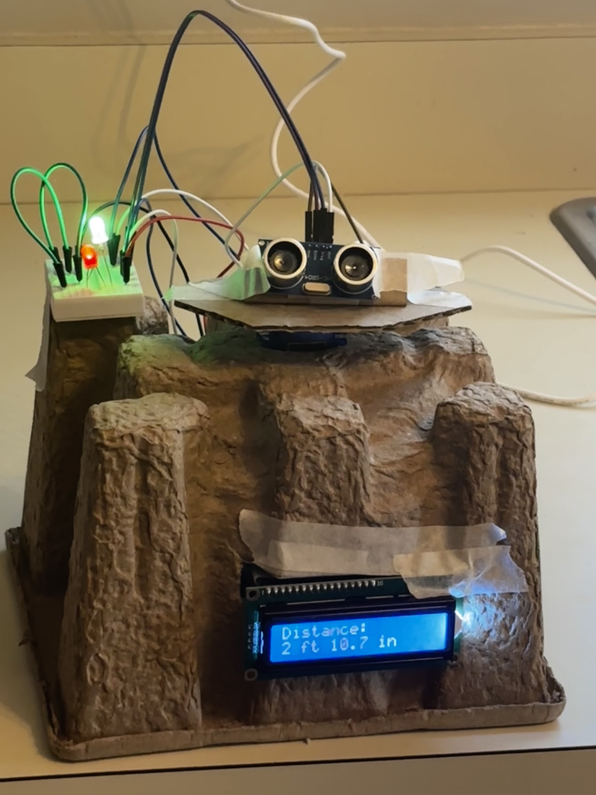
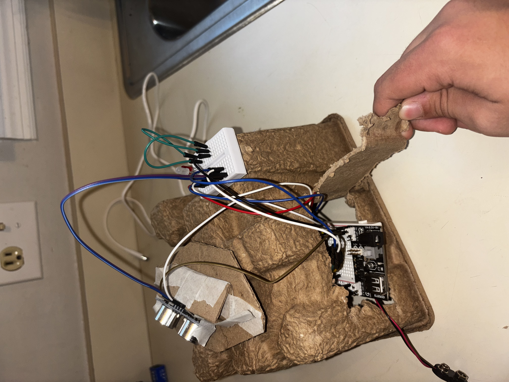
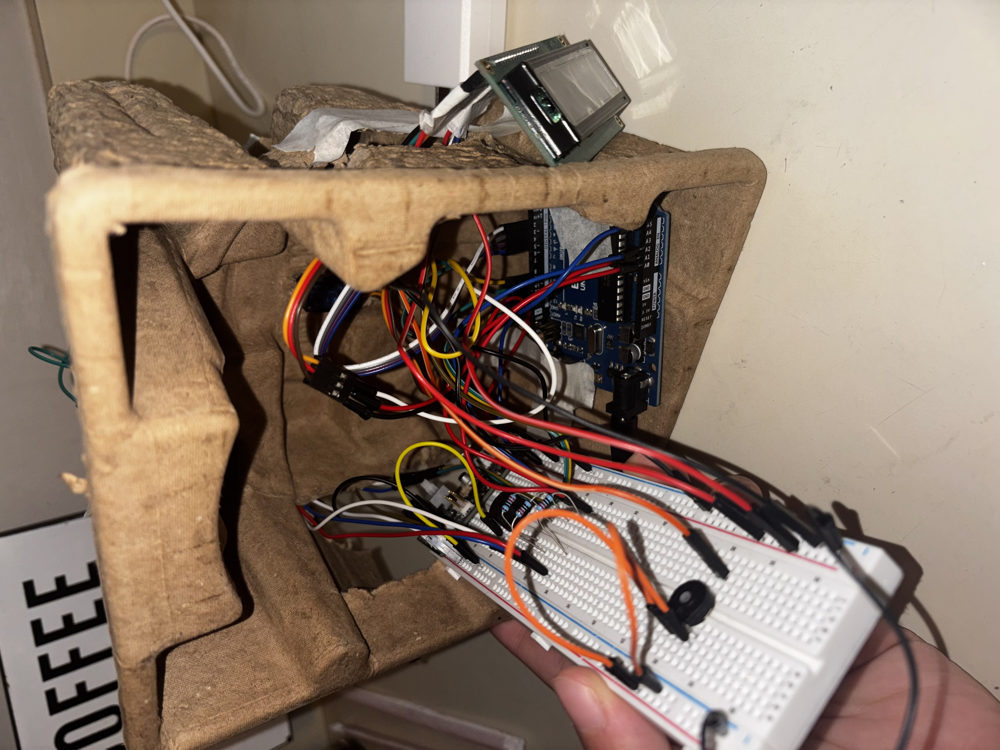

# Arduino Proximity Scanner

An Arduino-based embedded system that continuously scans its surroundings, measures object distance, and provides visual and audible warnings based on proximity.

## Project Overview

This project was built to practice embedded systems programming and integrating multiple hardware components into one system.

A servo motor continuously sweeps an HC-SR04 ultrasonic sensor across an area. The sensor measures object distance, while a 16x2 LCD displays the current measurement. An RGB LED and passive buzzer indicate different proximity levels.

## Current Features - Version 1

- Continuous servo scanning from 20° to 160°
- Real-time ultrasonic distance measurement
- Distance displayed in feet and inches on a 16x2 LCD
- Green indicator for safe distances
- Yellow indicator for the warning zone
- Red danger state for close objects
- Audible warnings with different beep rates based on distance
- Non-blocking timing using `millis()`
- Modular C++ functions for each subsystem

## Hardware

- Arduino Uno
- HC-SR04 ultrasonic sensor
- Servo motor
- 16x2 LCD display
- Common-cathode RGB LED
- Passive buzzer
- Potentiometer
- Breadboard
- Resistors
- Jumper wires
- External breadboard power supply

## How It Works

The servo continuously sweeps the ultrasonic sensor between 20° and 160°.

The ultrasonic sensor sends a pulse and measures how long it takes for the echo to return. The Arduino uses this measurement to calculate the object's distance.

**Safe:** Green LED, buzzer off

**Warning:** Yellow LED, slow audible warning

**Danger:** Red LED, faster and higher-pitched audible warning

The measured distance is simultaneously displayed on the LCD in feet and inches.

## Software Structure

- `updateServo()` - controls scanning motion
- `measureDistance()` - reads the ultrasonic sensor
- `updateLCD()` - displays the current distance
- `updateWarningSystem()` - determines the warning state
- `updateBuzzer()` - controls non-blocking audible alerts
- `setColor()` - controls the RGB LED

Using `millis()` allows multiple parts of the system to operate without relying heavily on blocking delays.

## Known Hardware Issue

The red channel of the RGB LED used during Version 1 testing is currently nonfunctional due to a hardware issue with the LED itself. The warning-state logic is implemented in software, but the LED will be replaced.

## Project Build

### Hardware Setup

  
  

## Demo

Version 1 demonstrates continuous area scanning, real-time distance measurement, and automatic visual and audible warning responses when an object enters the warning or danger zones.

[▶ Watch the Version 1 Demo](https://youtube.com/shorts/jyxK6KUi9S4?si=MJRMJU0ft94h1kxm)

## Experimental Object Tracking (Version 2 Prototype)

After completing Version 1, I experimented with object tracking using the **same Arduino Uno, HC-SR04 ultrasonic sensor, and servo motor**. The recovered prototype sketch is available here: [Arduino_Proximity_Scanner_V2_Experimental.ino](Arduino_Proximity_Scanner_V2_Experimental.ino).

### Implementation

The prototype uses two operating modes:

- **SCANNING:** Sweep the ultrasonic sensor to detect objects within the 48-inch warning range.
- **TRACKING:** Sample distance at the current servo angle and at offsets of 8° to either side, then move the tracking center toward the closest valid reading. After three cycles with no valid detection, return to scanning.

The tracking routine is implemented as four sequential steps: command the center angle, measure center, measure left, and measure right before selecting the next direction. The sketch uses a **150 ms settling interval** before each of the three measurements, giving a minimum of approximately **450 ms per tracking decision**, plus sensor-read and processing time. A single ultrasonic measurement can also wait up to 25 ms for an echo.

### Results and Limitations

The experimental prototype achieved basic tracking, but it did not follow moving objects as quickly or reliably as I wanted. I suspected that relying on a single rotating ultrasonic sensor limited how frequently the system could observe the object's position. Reviewing the recovered code also identified the sequential measurement waits as a likely source of additional delay.

I did not isolate or measure the relative contributions of sensor coverage, servo response, and algorithm timing. A future revision could compare shorter settling intervals, different sensing arrangements, and measured tracking response times.

**Documentation note:** This code was recovered from the original development work after the hardware had been disassembled. It is provided as an **experimental, previously tested prototype**, not as a verified finished tracking system. The repository's Version 1 demo shows the original scanner, not this tracking extension.

## Project Status

**Version 1:** Working and documented in this repository.

**Version 2:** Experimental object-tracking prototype recovered and archived. Basic tracking was observed during development, but responsiveness did not meet the design goal. The hardware is no longer assembled, and the recovered sketch has not been retested.
